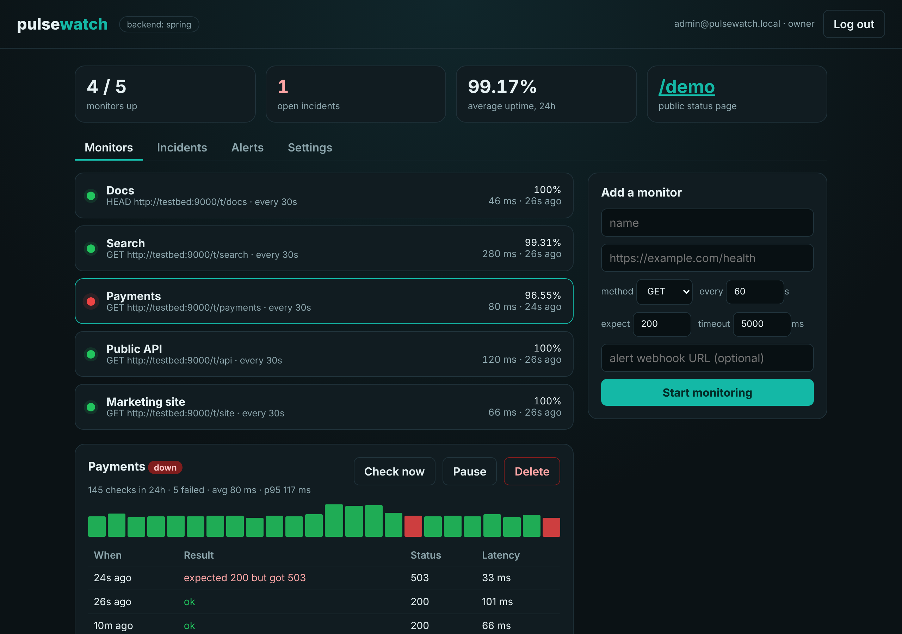
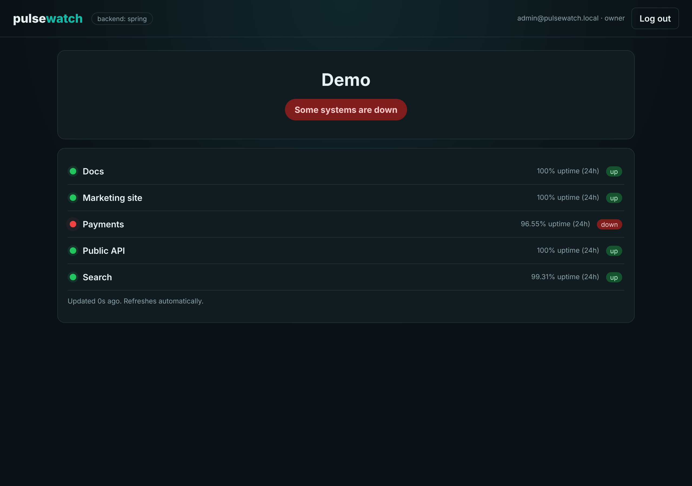
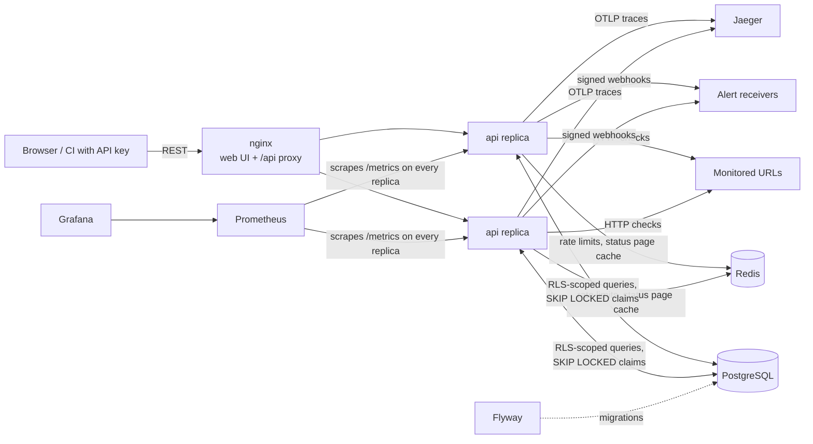

# pulsewatch

A self-hostable uptime monitor: it checks your URLs on a schedule, opens an incident when one goes down, sends a signed webhook, and publishes a public status page.

The same API is implemented three times, in **Spring Boot**, **Node.js/Express** and **ASP.NET Core**, on one shared PostgreSQL schema. The implementations are interchangeable to the point that all three can run at once behind one load balancer, splitting the checks between them.


## Introduction

An uptime monitor looks simple from the outside, but it's mostly background work that has to be correct when several copies of it run at once. pulsewatch covers the whole loop:

1. **Organise.** Registering creates an organisation and makes you its owner. Owners add admins and viewers. Admins create API keys for scripts and CI.
2. **Check.** Each monitor has a URL, a method, an interval, a timeout and an expected status. A scheduler in every API replica claims due monitors with `FOR UPDATE SKIP LOCKED`, so a check runs once however many replicas there are.
3. **Detect.** The first failed check opens an incident and the first passing one resolves it. A partial unique index guarantees at most one open incident per monitor, even with replicas racing.
4. **Alert.** Opening or resolving an incident queues a webhook job in the same transaction. Workers deliver it with an HMAC-SHA256 signature and retry with exponential backoff, up to five attempts.
5. **Publish.** Every organisation gets a public status page with 24-hour uptime, cached in Redis.

What it shows:

| Concern | How |
| --- | --- |
| Multi-tenancy | PostgreSQL row-level security: the backends connect as a restricted role, and every request sets `app.org_id` for its transaction, so a forgotten `WHERE` still can't leak another org's rows |
| Distributed work | Scheduler and alert queue in Postgres with `FOR UPDATE SKIP LOCKED` and leases; works across replicas and across languages |
| Reliability | Transactional outbox-style alert jobs, exponential backoff, dead-lettering after 5 attempts, retention sweeps |
| Auth | JWT (HS256) for people, hashed API keys (`X-API-Key`) for machines, three roles, per-key rate limiting in Redis with `Retry-After` |
| Webhooks | HMAC-SHA256 signatures over the exact stored body (`X-Pulsewatch-Signature: sha256=…`) |
| Observability | Prometheus metrics with the same names in every backend, a provisioned Grafana dashboard, OpenTelemetry traces in Jaeger |
| Data | Composite foreign keys that keep child rows in their monitor's org, partial indexes, `percentile_cont` for p95 latency, Flyway migrations |
| API design | OpenAPI 3 contract, RFC 7807 problem responses with machine-readable codes |
| Operations | Docker Compose, nginx across replicas, GitHub Actions running the same suite against each backend and all three together |

## Interface



The web UI (plain HTML and JavaScript, served by nginx) shows every monitor with its status, 24-hour uptime and latency. Selecting one shows hourly latency bars, failed hours in red, and the latest checks. Other tabs list incidents and alert deliveries, and the settings tab manages API keys and members and shows the webhook secret. The header shows which backend answered.

Every organisation has a public status page at `/#status=<slug>`, with no login and no URLs exposed:



The REST API is in [`contract/openapi.yaml`](contract/openapi.yaml) (paste it into [editor.swagger.io](https://editor.swagger.io) to browse it):

| Method | Path | Notes |
| --- | --- | --- |
| `POST` | `/api/auth/register`, `/api/auth/login` | Register creates an org and its owner. Both return `{ token, user }` |
| `GET` | `/api/me`, `/api/org` | The org's `webhookSecret` is shown to owners and admins only |
| `GET` / `POST` | `/api/members` | Adding members is owner only |
| `GET` / `POST` / `DELETE` | `/api/api-keys`, `/api/api-keys/{id}` | Owner or admin, signed in with a JWT. The key is returned once |
| `GET` / `POST` | `/api/monitors` | Creating needs owner or admin. The first check runs right away |
| `GET` / `PATCH` / `DELETE` | `/api/monitors/{id}` | Any change triggers an immediate check |
| `POST` | `/api/monitors/{id}/check` | Check as soon as possible (`202`) |
| `GET` | `/api/monitors/{id}/checks`, `/api/monitors/{id}/stats` | Recent results, and 24h uptime, average and p95 latency, hourly buckets |
| `GET` | `/api/incidents?status=open`, `/api/alerts` | Incident history and webhook deliveries |
| `GET` | `/api/status/{slug}` | Public and cached (`X-Cache: HIT/MISS`) |

Requests authenticate with `Authorization: Bearer <JWT>` or `X-API-Key: pw_…`. An API key acts as an admin of its org. It can't manage keys or members, and it's limited to `RATE_LIMIT_MAX` requests a minute. Errors look like this everywhere:

```json
{ "type": "about:blank", "title": "Too many requests for this API key", "status": 429, "code": "RATE_LIMITED", "detail": "limit is 60 per 60s" }
```

A webhook delivery looks like this:

```http
POST /your/hook HTTP/1.1
Content-Type: application/json
X-Pulsewatch-Event: monitor.down
X-Pulsewatch-Signature: sha256=5d1f…

{"event":"monitor.down","monitor":{"id":"…","name":"Payments","url":"https://…"},"incidentId":"…","cause":"expected 200 but got 503","at":"2026-11-08T01:30:23.625Z"}
```

To verify it, compute `HMAC-SHA256(webhookSecret, raw body)` and compare it with the header.

## Architecture



**Tenant isolation.** Flyway migrates as the database owner and creates `pulsewatch_app`, a login role that is not the owner and not a superuser. The tenant tables have `FORCE ROW LEVEL SECURITY` and one policy:

```sql
USING (org_id = nullif(current_setting('app.org_id', true), '')::uuid
       OR current_setting('app.bypass_rls', true) = 'on')
```

Each request runs in a transaction that starts with `SELECT set_config('app.org_id', $1, true)`. The setting is transaction-local, so a pooled connection never carries one org into the next request. Background jobs that work across orgs (scheduler, alert worker, retention) set `app.bypass_rls` instead. API keys are resolved by a `SECURITY DEFINER` function, because the org isn't known until the key is. Child tables reference `(monitor_id, org_id)`, so a check or incident can't point at another org's monitor.

**One check, start to finish:**

1. Each replica's scheduler runs every second. It sets `next_check_at = now() + interval` on up to 50 due monitors, chosen with `FOR UPDATE SKIP LOCKED`, and gets them back with `RETURNING`.
2. Each check runs in the background with its own timeout and without following redirects. Latency is measured to the response headers.
3. One transaction locks the monitor row, stores the result, sets the new status, opens or resolves the incident and, if there's a webhook URL, inserts the alert job with its final JSON body.
4. The alert worker claims due jobs with `SKIP LOCKED` and a 60-second lease. It signs the stored body, POSTs it, and then marks the job `sent`, schedules a retry after 2^attempts seconds, or marks it `dead` after the fifth attempt.

**Schema** ([`db/migrations`](db/migrations)): `orgs`, `users`, `api_keys` (SHA-256 only), `monitors`, `check_results`, `incidents`, `alert_jobs`. The third migration adds the role, the grants and the policies. A demo organisation with the slug `demo` comes with the first one.

**Redis keys** (identical in every backend): `pw:rl:{keyId}:{window}` is the fixed-window counter for each API key, and `pw:status:{slug}` caches the status page for `CACHE_TTL_SEC` seconds.

**Metrics** (identical names in every backend, scraped from port 8000 of each replica, which nginx does not expose):

| Metric | Labels |
| --- | --- |
| `pulsewatch_checks_total` | `result` = `success` or `failure` |
| `pulsewatch_check_duration_seconds` | histogram |
| `pulsewatch_alerts_total` | `outcome` = `sent`, `retry` or `dead` |

## Modular backend

Three interchangeable implementations of the same contract:

| | Spring Boot | Express | ASP.NET Core |
| --- | --- | --- | --- |
| Folder | [`backends/spring`](backends/spring) | [`backends/express`](backends/express) | [`backends/dotnet`](backends/dotnet) |
| Language | Java 21 | TypeScript (Node 22) | C# 12 (.NET 8) |
| HTTP | Spring MVC | Express 4 | Minimal APIs |
| Data access | `JdbcClient` + `TransactionTemplate` | `pg` | Npgsql + Dapper |
| Background work | `@Scheduled` + virtual threads | async loops | `BackgroundService` |
| Outgoing HTTP | `java.net.http.HttpClient` | `fetch` (undici) | `IHttpClientFactory` |
| Auth | Spring Security resource server + API key filter | `jsonwebtoken` + middleware | JwtBearer + custom `AuthenticationHandler` behind a policy scheme |
| Metrics | Micrometer + Actuator | `prom-client` | `prometheus-net` |
| Tracing | Micrometer Tracing (OTel bridge) | OpenTelemetry Node SDK | OpenTelemetry .NET |
| Unit tests | JUnit 5 + AssertJ | Vitest | xUnit |

What makes them interchangeable:

- **One schema**, migrated once by Flyway before any backend starts, with the same row-level security for all of them.
- **One contract**: [`contract/openapi.yaml`](contract/openapi.yaml) covers paths, payloads, status codes, error codes, failure messages and the webhook format.
- **Shared runtime conventions**: the Redis keys, the JWT claims (`sub`, `email`, `role`, `org`, `iss=pulsewatch`), the API key format, the signature, the backoff and the metric names. Each backend's unit tests pin the same values.
- **One test suite**: [`tests/contract`](tests/contract) only talks HTTP. CI runs it against each backend with three replicas, and once more against all three backends at the same time.

To pick a backend:

```bash
BACKEND=dotnet docker compose up --build
```

To run all three at once (nginx balances across them, and their schedulers share the checks):

```bash
docker compose -f docker-compose.yml -f docker-compose.mixed.yml up --build
```

## Usage

### Quick start

You need Docker with Compose v2.

```bash
git clone https://github.com/Khalil002/pulsewatch.git
cd pulsewatch
docker compose up --build
```

| URL | What |
| --- | --- |
| <http://localhost:8080> | The app. Log in as the demo owner (`admin@pulsewatch.local` / `admin1234`) or register your own organisation |
| <http://localhost:8080/#status=demo> | The demo organisation's public status page |
| <http://localhost:3000> | Grafana, with the pulsewatch dashboard as the home page |
| <http://localhost:9090> | Prometheus |
| <http://localhost:16686> | Jaeger traces |

The default backend is Spring Boot. For targets that fail on demand, add the testbed: `docker compose --profile testbed up --build`, then monitor `http://testbed:9000/t/anything` and change its answer with `curl -X PUT localhost:9000/targets/anything -d '{"status":503}'`.

### Self-hosting guide

1. **Install Docker.** Docker Desktop on macOS or Windows, or Docker Engine plus the Compose plugin on Linux. Check with `docker compose version`.
2. **Get the code.** `git clone https://github.com/Khalil002/pulsewatch.git && cd pulsewatch`
3. **Configure.** `cp .env.example .env`, then edit `.env`:
   - `BACKEND`: `spring`, `express` or `dotnet`.
   - `JWT_SECRET`: set a long random value, for example from `openssl rand -hex 32`. It must be at least 32 characters.
   - `DB_ADMIN_PASSWORD` and `APP_DB_PASSWORD`: change both from the defaults. The first is the owner account the migrations use. The second is the restricted account the API uses.
   - `GRAFANA_ADMIN_PASSWORD`: change it, or remove the Grafana, Prometheus and Jaeger ports from `docker-compose.yml` if you don't want them reachable.
   - `WEB_PORT`: the port the site listens on (default 8080).
4. **Start it.** `docker compose up -d --build`. The first build downloads dependencies and takes a few minutes.
5. **Check it.** `curl http://localhost:8080/api/health` should return `{"status":"ok","backend":"..."}`.
6. **Remove the demo organisation.** Register your own organisation in the UI first, then delete the demo one (this removes its owner and monitors too):
   ```bash
   docker compose exec postgres psql -U pulsewatch -c "DELETE FROM orgs WHERE slug = 'demo';"
   ```
7. **Expose it (optional).** Put a TLS-terminating reverse proxy such as Caddy or Traefik in front of port 8080. Monitors can reach anything the API containers can reach, including your internal network. That's what you want for internal health checks, but if you let strangers register, restrict the containers' outbound network.
8. **Operate it.**
   - Logs: `docker compose logs -f api`
   - Scale out: `docker compose up -d --scale api=3` (checks are split between replicas automatically)
   - Switch backend: change `BACKEND` in `.env`, then `docker compose up -d --build api`
   - Back up: `docker compose exec postgres pg_dump -U pulsewatch pulsewatch > backup.sql`
   - Stop: `docker compose down` (add `-v` to delete the data too)

### Configuration

| Variable | Default | Meaning |
| --- | --- | --- |
| `BACKEND` | `spring` | Which implementation to build and run |
| `WEB_PORT` | `8080` | Host port for the UI and API |
| `JWT_SECRET` | dev value | HS256 signing secret shared by every replica |
| `DB_ADMIN_PASSWORD` | `pulsewatch` | Database owner, used only by the migrations |
| `APP_DB_PASSWORD` | `pulsewatch_app` | Restricted role the API connects as |
| `RATE_LIMIT_MAX` / `RATE_LIMIT_WINDOW_SEC` | `60` / `60` | Requests one API key may make per window |
| `CACHE_TTL_SEC` | `5` | Lifetime of a cached status page |
| `RETENTION_DAYS` | `30` | Days of check history to keep |
| `OTEL_EXPORTER_OTLP_ENDPOINT` | `http://jaeger:4318` | Where traces go. Set it to an empty value to turn tracing off |
| `GRAFANA_PORT` / `PROMETHEUS_PORT` / `JAEGER_PORT` | `3000` / `9090` / `16686` | Host ports for the observability tools |

### Running a backend from source

Start only the infrastructure, with its ports on localhost:

```bash
docker compose -f docker-compose.yml -f docker-compose.dev.yml up -d postgres redis migrate jaeger
```

Then run one backend on port 8000. Its defaults point at that infrastructure; set `OTEL_EXPORTER_OTLP_ENDPOINT=http://localhost:4318` to send traces.

```bash
cd backends/express && npm install && npm run dev             # Node 22
cd backends/spring && mvn spring-boot:run                       # Java 21
cd backends/dotnet && dotnet run --project src/Pulsewatch.Api   # .NET 8
```

## Testing

| Suite | Command | What it covers |
| --- | --- | --- |
| Contract (all backends) | `docker compose --profile testbed up -d --build`, then `cd tests/contract && npm install && npm test` | 39 black-box tests: registration and login, tenant isolation, roles, API keys (scope, revocation, rate limiting), monitor validation and CRUD, checks (status, `HEAD`, timeouts, refused connections, on-demand, paused), incidents opening and resolving once, 24h stats, signed webhooks with retry and backoff, and the cached public status page |
| Express unit | `cd backends/express && npm test` | Slugs, API keys, signatures, payload format, backoff, check outcomes, incident transitions |
| Spring unit | `cd backends/spring && mvn test` | The same rules |
| ASP.NET unit | `cd backends/dotnet && dotnet test` | The same rules, plus URL validation |

The contract tests drive a testbed container: fake targets whose status and delay they set, and webhook receivers that record what arrives or fail on purpose. `API_URL`, `TESTBED_URL` and `TARGET_URL` (the testbed as the backend sees it) override the defaults.

CI ([`.github/workflows/ci.yml`](.github/workflows/ci.yml)) runs the unit tests, then the contract suite against each backend with three API replicas, and once more with Spring, Express and ASP.NET all serving at the same time.

## Project layout

```
contract/openapi.yaml        the API every backend implements
db/migrations/               Flyway SQL with row-level security, shared by all backends
backends/spring|express|dotnet
tests/contract/              black-box suite (Vitest, fetch)
scripts/testbed/             fake targets and webhook receivers
web/                         static UI and status page
deploy/nginx.conf            UI hosting and /api proxying
deploy/prometheus, grafana/  scrape config, datasource and dashboard provisioning
docker-compose.yml           the whole stack
docker-compose.mixed.yml     all three backends side by side
docker-compose.dev.yml       exposes infra ports for local development
```
